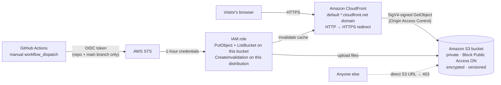

# Architecture — AWS-hosted portfolio

Status: **designed and validated, not yet deployed.** GitHub Pages remains the live host until the AWS deployment has been created and tested.

## Overview

## Components

| Component | Purpose | Key settings |
|---|---|---|
| **S3 bucket** | Stores `index.html`, `404.html` and (later) `cv.pdf` | All four Block Public Access settings on, ACLs disabled (BucketOwnerEnforced), SSE-S3 encryption, versioning with 30-day expiry of old versions, `DeletionPolicy: Retain` |
| **CloudFront distribution** | Global CDN and HTTPS endpoint | `redirect-to-https`, HTTP/2 + HTTP/3, compression, `DefaultRootObject: index.html`, PriceClass_100 (Europe + North America edges), default CloudFront certificate |
| **Origin Access Control (OAC)** | Lets only CloudFront read the private bucket | Signs every origin request with SigV4 (`SigningBehavior: always`). Replaces the legacy Origin Access Identity |
| **Bucket policy** | Authorises the read | `s3:GetObject` for `cloudfront.amazonaws.com` only when `AWS:SourceArn` equals **this** distribution. Also denies any non-HTTPS request |
| **Cache policy** | Caching | AWS managed *CachingOptimized*. The workflow sets `Cache-Control: max-age=300` on HTML and `max-age=3600` on other files, so updates show within minutes |
| **Response headers policy** | Security headers | AWS managed *SecurityHeadersPolicy* (HSTS, X-Content-Type-Options, X-Frame-Options, Referrer-Policy) |
| **Error handling** | Missing pages | 403 and 404 from the origin return `/404.html` with status 404, cached 60 s. With OAC and no `s3:ListBucket` for CloudFront, S3 answers 403 for a missing key, so both codes are mapped |
| **GitHub OIDC provider** | Trust between AWS and GitHub | `token.actions.githubusercontent.com`, audience `sts.amazonaws.com`. Created by the stack unless the account already has one |
| **Deploy IAM role** | What the workflow may do | Trust: only `repo:NadavaluruSashank/Portfolio_website:ref:refs/heads/main`. Permissions: `s3:ListBucket` on the bucket, `s3:PutObject` on its objects, `cloudfront:CreateInvalidation`/`GetInvalidation` on this distribution. No delete, no other buckets, no IAM |

## Deployment flow

1. You run the **Deploy to AWS** workflow manually (Actions tab → *Deploy to AWS (S3 + CloudFront)* → *Run workflow* on `main`).
2. **check** job: `cloud/aws/check_site.py` verifies the HTML files exist, in-page anchors resolve, the JSON-LD is valid, metadata is present, links use HTTPS, a configured CV file exists, and no credentials are committed.
3. **deploy** job: GitHub issues an OIDC token; `aws-actions/configure-aws-credentials` exchanges it with STS for 1-hour credentials for the deploy role. No access keys are stored.
4. Only website files (`index.html`, `404.html`, `cv.pdf` if present) are copied to a `dist/` folder and uploaded. The `cloud/`, `.github/` and README files are never uploaded.
5. One invalidation of `/*` (counts as a single path) and a wait for it to finish.
6. Verification: CloudFront URL must return 200, plain HTTP must redirect, and the direct S3 URL must return **403** (proves the bucket is private). The URL is written to the job summary.

## Invalidation strategy

HTML is cached for 5 minutes, so even without an invalidation an update appears quickly. The workflow still invalidates `/*` after each deploy so changes are immediate. AWS counts a wildcard as one path; the first 1,000 paths per month are free.

## Security decisions and accepted trade-offs

A `checkov` scan of `template.yaml` passed 19 checks and flagged 4. They are deliberate for a low-cost personal site:

| Finding | Decision |
|---|---|
| S3 access logging off (CKV_AWS_18) | Not needed: the bucket is private and only CloudFront reads it. Logging would need a second bucket and storage costs |
| CloudFront access logging off (CKV_AWS_86) | Skipped to avoid log storage costs. Can be added later with a log bucket |
| No AWS WAF (CKV_AWS_68) | A web ACL costs a fixed monthly fee plus per-rule fees, which is more than the rest of this setup combined. A static site with no forms or backend has little attack surface. CloudFront includes AWS Shield Standard DDoS protection at no extra cost |
| TLS 1.2 minimum not enforced (CKV_AWS_174) | A custom minimum TLS version requires your own certificate and custom domain. With the default `*.cloudfront.net` certificate, AWS controls the TLS policy. Revisit if a custom domain is approved |

## Why not EC2 or RDS?

The site is static HTML, CSS and JavaScript. A server (EC2) or database (RDS) would add monthly cost, patching and attack surface with no benefit. S3 + CloudFront serves static files directly and scales automatically.

## Future options (need your approval and cost review)

- Custom domain with Route 53 and a free ACM certificate (domain registration costs money).
- Switch the workflow trigger to `push` on `main` once manual runs are verified.
- CloudFront access logs to a separate bucket.
